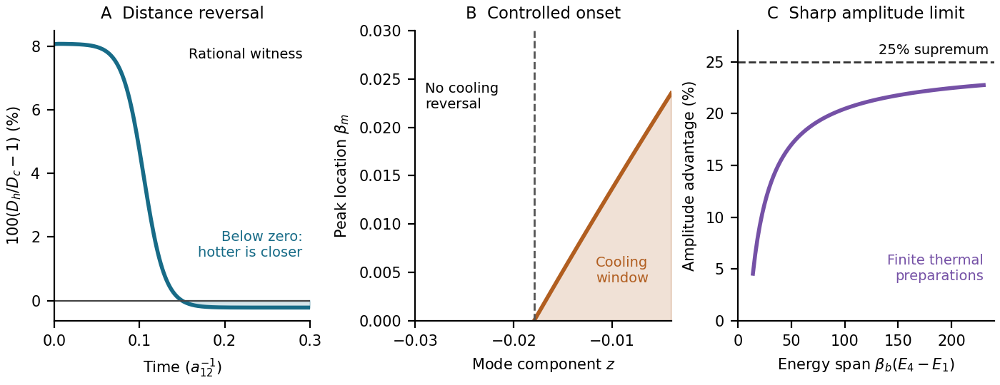

# Figures and plotting data

[Project home](../../README.md) · [Outputs](../README.md) · [Research map](../../docs/RESEARCH_MAP.md)

The overview combines the focused paper's rational-witness distance reversal,
controlled onset of a cooling window, and approach to the sharp amplitude limit.
These plots illustrate the mathematics; the image alone is not a certificate of
a finite crossing time. The [overview receipt](focused_overview_receipt.json)
states its numerical scope.

| Figure | View or download | Associated data and records |
| --- | --- | --- |
| Focused-paper overview | [PNG](focused_overview.png) · [PDF](focused_overview.pdf) | [Relaxation data](focused_relaxation.csv) · [receipt](focused_overview_receipt.json) |
| Relaxation crossing | [PNG](relaxation_crossing.png) · [PDF](relaxation_crossing.pdf) | [Data](relaxation_data.csv) |
| Thermal overlap | [PNG](thermal_overlap.png) · [PDF](thermal_overlap.pdf) | [Data](overlap_data.csv) |
| Mechanism and onset | [PNG](mechanism_onset.png) · [PDF](mechanism_onset.pdf) | [Onset data](mechanism_onset.csv) · [curves](mechanism_curves.csv) |
| Quarter-limit family | [PNG](quarter_limit.png) · [PDF](quarter_limit.pdf) | [Gain data](quarter_gain_data.csv) · [overlap data](quarter_overlap_data.csv) · [receipt](quarter_plot_receipt.json) |
| Separate physical-model finite-time study | [PNG](physical_finite_time.png) · [PDF](physical_finite_time.pdf) | [Time-series data](physical_finite_time.csv) · [threshold savings](physical_threshold_savings.csv) |

The 25% supremum is an amplitude comparison, not a universal cooling-time gain.
The physical-model study uses a separate Arrhenius model with different triplet
conditions; it should not be read as experimental verification of the central
counterexample.

Data and receipts preserve their research-era scope. Fresh publication checks are
listed in [PACKAGE_CHECKS.json](../../PACKAGE_CHECKS.json); privacy checks are in
[PRIVACY_REPORT.json](../../PRIVACY_REPORT.json). See the
[reproduction guide](../../REPRODUCING.md) before rebuilding figures.
